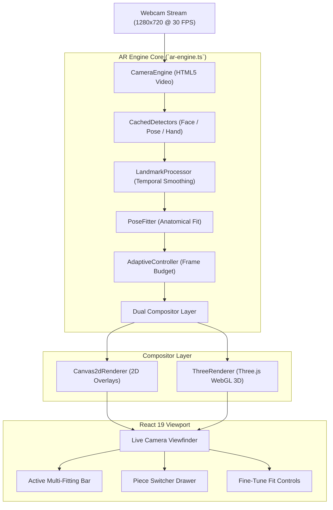

# Lumière — AI Virtual Jewellery Try-On Documentation

**Lumière** is an on-device, augmented reality atelier designed for real-time virtual jewellery try-on. It combines high-accuracy computer vision with real-time biometric landmark tracking to simulate photorealistic placement of fine jewellery—including earrings, necklaces, rings, and bangles—directly onto the user's live camera feed.

> [!IMPORTANT]
> The web atelier is **100% client-side and standalone**. Video frames never leave the user's browser, providing zero latency, sub-millimeter tracking accuracy, and complete biometric privacy without requiring any backend server or database setup.

---

## 📚 Documentation Index

For deep-dive technical specifications, refer to the dedicated guides in the [`docs/`](file:///C:/Users/ankus/Downloads/Virtual-try/docs/) directory:

1. [**Architecture Overview (`docs/ARCHITECTURE.md`)**](file:///C:/Users/ankus/Downloads/Virtual-try/docs/ARCHITECTURE.md): Complete system architecture, Next.js App Router structure, AR Engine core, dual-renderer design, and detector caching.
2. [**Virtual Fitting Studio (`docs/TRY_ON_STUDIO.md`)**](file:///C:/Users/ankus/Downloads/Virtual-try/docs/TRY_ON_STUDIO.md): Single-Piece Studio vs. Multi-Jewellery Studio (`/try-on/multi`), automatic direct transfer UX, Active Fitting bar, and necklace-only fine-tuning.
3. [**Computer Vision & Tracking (`docs/VISION_AND_TRACKING.md`)**](file:///C:/Users/ankus/Downloads/Virtual-try/docs/VISION_AND_TRACKING.md): Mathematical calibration formulas for MediaPipe FaceLandmarker, PoseLandmarkerLite, and HandLandmarker.
4. [**3D PBR Shading & Gem Materials (`docs/3D_SHADING_AND_MATERIALS.md`)**](file:///C:/Users/ankus/Downloads/Virtual-try/docs/3D_SHADING_AND_MATERIALS.md): Physically-based gemstone materials (Solitaire Diamond, Ruby, Sapphire, Emerald, Amethyst), two-pass bangle shaders, and finger occluders.
5. [**Developer & Contributor Guide (`docs/DEVELOPER_GUIDE.md`)**](file:///C:/Users/ankus/Downloads/Virtual-try/docs/DEVELOPER_GUIDE.md): Local development quick-start, production builds, adding new 2D/3D catalogue items, and troubleshooting.

---

## Table of Contents

- [1. Architecture Overview](#1-architecture-overview)
- [2. Multi-Jewellery Studio vs. Single-Piece Studio](#2-multi-jewellery-studio-vs-single-piece-studio)
- [3. Computer Vision & Landmark Alignment Calibration](#3-computer-vision--landmark-alignment-calibration)
  - [3.1 Earrings & Drops](#31-earrings--drops)
  - [3.2 Necklaces, Pendants & Mangalsutras](#32-necklaces-pendants--mangalsutras)
  - [3.3 3D Gemstone & Solitaire Rings](#33-3d-gemstone--solitaire-rings)
  - [3.4 3D Two-Pass Bangles & Kadas](#34-3d-two-pass-bangles--kadas)
- [4. Three.js PBR Shading & Occlusion Engine](#4-threejs-pbr-shading--occlusion-engine)
- [5. Performance & AR Pipeline Optimization](#5-performance--ar-pipeline-optimization)
  - [5.1 Persistent Detector Caching](#51-persistent-detector-caching)
  - [5.2 React State Throttle (97% Render Reduction)](#52-react-state-throttle-97-render-reduction)
  - [5.3 Decoupled Detection & 60 FPS Spring Interpolation](#53-decoupled-detection--60-fps-spring-interpolation)
- [6. Installation & Running](#6-installation--running)
- [7. Directory Structure](#7-directory-structure)
- [8. Catalogue & Asset Addition Guide](#8-catalogue--asset-addition-guide)
- [9. Troubleshooting & FAQ](#9-troubleshooting--faq)

---

## 1. Architecture Overview



The application runs **100% on the client device**. Video frames never leave the user's computer or browser, guaranteeing strict privacy, low power consumption, and instant real-time response.

---

## 2. Multi-Jewellery Studio vs. Single-Piece Studio

### 2.1 Single-Piece Studio (`/try-on` or `/try-on/[productId]`)
- **Focused Trial**: Evaluates one jewellery piece at a time with full universal fine-tuning (Size Ratio: 80%–120%, Vertical Position: ±30px).
- **Same-Category Swaps**: Picking another piece of the same category swaps the piece cleanly without stopping the camera.
- **Cross-Category Selection**: Selecting an item from a different category **directly transfers** the user into the Multi-Jewellery Studio without dropping or restarting the camera stream, fitting both pieces together immediately.

### 2.2 Multi-Jewellery Studio (`/try-on/multi`)
- **Multi-Category Trial**: Users can try on multiple items across categories simultaneously (Earrings + Necklace + Rings + Bangles).
- **Active Multi-Fitting Bar**: Interactive pill bar displaying all worn pieces with individual `× Remove` buttons.
- **Strict Necklace-Only Fine-Tuning**: In Multi Mode, fine-tune sliders are strictly dedicated to:
  1. **Necklace Size** (80% to 120%)
  2. **Necklace Length / Drape** (-30px to +30px vertical drop)
- If no necklace is equipped, an alert prompt guides the user: *"Add a necklace to the fitting to adjust size and drape length."*

---

## 3. Computer Vision & Landmark Alignment Calibration

### 3.1 Earrings & Drops
- **Landmark Anchors**: Dual earlobes via MediaPipe Face Mesh landmarks `177` (left earlobe) and `401` (right earlobe).
- **Dynamic Sizing**:
  $$\text{Earring Width} = \max\left(14,\; \min\left(64,\; \text{Face Width} \times 0.12\right)\right)$$
- **Attachment Point**: Anchor top hook at `originY = -h * 0.08` so the earring hangs naturally below the earlobe rather than floating over the cheek.
- **Perspective Occlusion**: Head yaw angle is tracked in real-time. When yaw exceeds $35^\circ$ ($0.61\text{ rad}$), the far-side earring automatically fades out with progressive opacity.

### 3.2 Necklaces, Pendants & Mangalsutras
- **Landmark Anchors**: Clavicle notch and shoulder acromia (MediaPipe Pose landmarks `11` = Left Shoulder, `12` = Right Shoulder):
  $$\vec{P}_{\text{neck\_base}} = \frac{\vec{P}_{11} + \vec{P}_{12}}{2}$$
- **Dynamic Sizing & Drape**:
  $$\text{Target Scale} = \max\left(0.60,\; \min\left(1.50,\; 1.0 + \frac{\text{fineTuneOffsetY}}{70}\right)\right) \times \frac{W_{\text{shoulder}}}{240}$$
- **Necklace Drape Offset**: Moving the slider up (negative Y) tightens into a choker collar; moving the slider down (positive Y) drops the chain onto the chest.

### 3.3 3D Gemstone & Solitaire Rings
- **Landmark Anchors**: Proximal and distal interphalangeal joints of the ring finger (`landmarks 13 & 14`).
- **Dynamic Rotation & Angle**:
  $$\theta = \arctan2(y_{14} - y_{13},\; x_{14} - x_{13}) + 90^\circ$$
- **Gram-Schmidt Orthogonalization**: Formulates a complete 3D basis matrix from finger vector $\hat{z}$ and palm normal $\vec{N}_{\text{palm}}$, converted to a Three.js Quaternion with SLERP smoothing.

### 3.4 3D Two-Pass Bangles & Kadas
- **Landmark Anchors**: Wrist center (`landmark 0`) and base of middle finger (`landmark 9`) defining the forearm vector.
- **Two-Pass Shading**:
  - Front band mesh: fully opaque (`depthWrite: true`, `renderOrder: 2`).
  - Back band mesh: translucent ($0.16$), darkened ($0.7\times$), `depthWrite: false`, `renderOrder: 1`.

---

## 4. Three.js PBR Shading & Occlusion Engine

### 4.1 Colored Gemstone Material Formula
- **Diamond (Solitaire)**: Uses transmission ($0.60$) and clear diamond dispersion.
- **Colored Gemstones (Ruby, Sapphire, Emerald, Amethyst)**:
  - `transmission = 0` (eliminates background reflection washout).
  - `emissiveIntensity = 0.35` (preserves stone saturation in dim camera lighting).
  - `clearcoat = 1.0` and `clearcoatRoughness = 0.05`.
  - `flatShading = true` (breaks light into distinct diamond cut facets).
  - Localized `PointLight` attached near the gem maintaining vivid hue.

| Product | Gem Color | Hex Code | Material Configuration |
|---|---|---|---|
| **Brilliant Solitaire** | Diamond White | `#FFFFFF` | Clear transmission PBR |
| **Royal Ruby Pavé** | Crimson Ruby | `#E0115F` | Opaque faceted PBR + Emissive tint |
| **Sapphire Halo** | Royal Blue | `#1E6FD9` | Opaque faceted PBR + Emissive tint |
| **Imperial Emerald** | Emerald Green | `#2ECC71` | Opaque faceted PBR + Emissive tint |
| **Amethyst Sovereign**| Royal Violet | `#9B59B6` | Opaque faceted PBR + Emissive tint |

### 4.2 Occlusion & Shadows
- **Finger Occluder Cylinder**: Invisible cylinder ($0.85\times$ inner ring radius, `colorWrite: false`, `depthWrite: true`, `renderOrder: 0`) masking the rear arc of the ring behind the finger.
- **Contact Shadow Texture**: Soft radial blob shadow grounded onto the skin under the ring shank.

---

## 5. Performance & AR Pipeline Optimization

### 5.1 Persistent Detector Caching
- MediaPipe models (`face`, `pose`, `hand`) are loaded once and stored in `this.cachedDetectors`. Swapping jewellery never tears down or re-downloads models.

### 5.2 React State Throttle (97% Render Reduction)
- Throttled continuous FPS state updates to once every 500ms. Critical transitions (`status`, `promptMessage`, `error`) remain immediate, eliminating slider drag lag.

### 5.3 Decoupled Detection & 60 FPS Spring Interpolation
- Heavy ML inference runs at ~15–20 Hz in WebAssembly workers.
- The `PoseFitter` calculates continuous 60 FPS positions using second-order exponential spring-damping.

---

## 6. Installation & Running

### Requirements
- Node.js 18+ (Node.js 20+ recommended)
- `pnpm` (recommended) or `npm`

### Quick Start
```bash
# 1. Navigate to frontend
cd frontend

# 2. Install dependencies
pnpm install

# 3. Start development server
pnpm dev

# Or run via Windows batch file:
# run_web.bat
```

Open: **`http://localhost:3000`**

### Production Build & Typecheck
```bash
cd frontend
pnpm typecheck   # Static typecheck (0 errors)
pnpm build       # Optimized Next.js production build
pnpm start       # Start production server
```

---

## 7. Directory Structure

```text
Virtual-try/
├── run_web.bat                     # Windows launch batch script
├── DOCUMENTATION.md                # Master system documentation
├── README.md                       # Repository overview & quick start
├── docs/                           # Dedicated modular technical guides
│   ├── ARCHITECTURE.md             # System architecture & component design
│   ├── TRY_ON_STUDIO.md            # Studio modes, multi-try UX & fine-tuning
│   ├── VISION_AND_TRACKING.md      # Computer vision & anatomical math
│   ├── 3D_SHADING_AND_MATERIALS.md # PBR materials, gems & two-pass shaders
│   └── DEVELOPER_GUIDE.md          # Local setup, testing & product addition
├── static/                         # Desktop assets & shared PNG overlays
│   └── Image/                      # Earrings, Necklaces, Rings, Bangles
└── frontend/                       # Standalone Next.js 15 Web Atelier
    ├── public/                     # Public assets & WASM model runtimes
    └── src/
        ├── app/                    # Next.js App Router (/, /try-on, /try-on/multi)
        ├── ar-engine/              # AR Engine core (camera, detectors, renderers)
        ├── features/try-on/        # Studio UI, Camera Viewfinder, Fine-Tune Sliders
        ├── components/             # Storefront components
        └── ui/                     # Design system components
```

---

## 8. Catalogue & Asset Addition Guide

### Adding New Pieces:
1. **2D PNG Overlays**: Place 32-bit transparent PNG in `frontend/public/static/Image/<Category>/`.
2. **3D Rings / Bangles**: Define a `ringConfig` or `bangleConfig` specifying gem color, metal, and accents.
3. **Register in Catalogue**: Add the item definition to [`frontend/src/features/try-on/fallback-catalogue.ts`](file:///C:/Users/ankus/Downloads/Virtual-try/frontend/src/features/try-on/fallback-catalogue.ts).

---

## 9. Troubleshooting & FAQ

#### Q1: "Camera access is blocked or black screen appears in the browser"
- Check browser permissions by clicking the padlock or camera icon in the URL bar and select **Allow**.
- Ensure no other application (e.g. Zoom, Teams) has an exclusive hardware lock on the webcam.

#### Q2: "Can I try out multiple jewellery pieces at once?"
- **Yes.** Navigate to `/try-on/multi` or select any item of a different category in the studio. The studio will directly transfer to Multi-Jewellery Mode without stopping the camera feed.

#### Q3: "Why can I only adjust necklace size and length in multi-fitting mode?"
- In Multi-Jewellery Mode, non-necklace pieces (earrings, rings, bangles) are locked to calibrated anatomical tracking. The Fine-Tune controls focus specifically on necklace size and neckline drape to prevent UI clutter and ensure bridal sets fit naturally.

#### Q4: "Do I need a backend server to run the virtual studio?"
- **No.** The web application is 100% self-contained. All computer vision models, 3D engines, and catalogues run locally inside your browser.

---

*Lumière Luxury Virtual Jewellery Studio © 2026. All rights reserved.*
