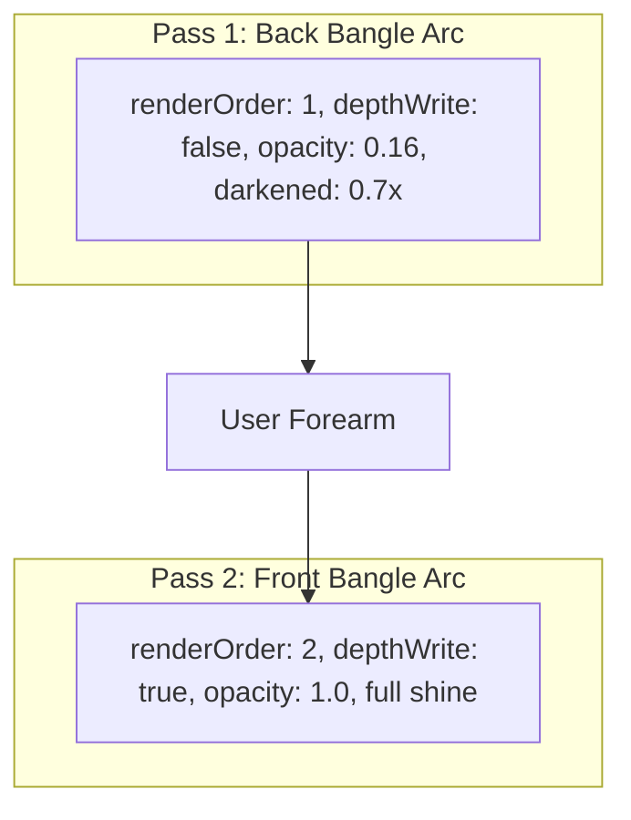

# 3D PBR Shading, Gem Materials & Occlusion

> [!NOTE]
> Lumière's 3D engine (`ThreeRenderer`) runs on **Three.js** with WebGL 2.0, HDR environment lighting (`RoomEnvironment`), and custom physical materials.

---

## 1. Colored Gemstone Material Formula

### Why Colored Gems Looked White (Root Cause)
In standard Three.js `MeshPhysicalMaterial`, setting `transmission > 0` causes light rays to pass directly through the mesh, refracting the HDR white background environment map. In AR try-on, this washes out colored gemstones (rubies, sapphires, emeralds) into translucent white.

### The Realistic Gem Solution
1. **Diamond (Brilliant Solitaire)**: Uses transmission ($0.60$) and clear diamond dispersion.
2. **Colored Gemstones (Ruby, Sapphire, Emerald, Amethyst)**: Transmission is set to **`0`**. A dedicated `MeshPhysicalMaterial` with facet flat-shading, emissive tint, and a localized point light is created per piece:

```typescript
// frontend/src/ar-engine/renderers/three-renderer.ts
new THREE.MeshPhysicalMaterial({
  color: new THREE.Color(gemColor),
  emissive: new THREE.Color(gemColor),
  emissiveIntensity: 0.35,        // Prevents saturation loss in dim camera lighting
  metalness: 0.0,
  roughness: 0.05,
  transmission: isDiamond ? 0.60 : 0.0, // Strictly 0 for colored stones
  transparent: false,
  opacity: 1.0,
  ior: 2.2,                       // Realistic gemstone refractive index
  clearcoat: 1.0,
  clearcoatRoughness: 0.05,
  envMapIntensity: 0.60,          // Balanced so reflections do not overpower stone color
  flatShading: true,              // Emphasizes individual cut-gem facets
});
```

---

## 2. Product Gem Color Configurations

| Product Name | Category | Gem Color Code | Hex Preview | Material Type |
|---|---|---|---|---|
| **Brilliant Solitaire Diamond** | Solitaires | `#FFFFFF` |  White | Clear Transmission PBR |
| **Royal Ruby Pavé Crown** | Halo Rings | `#E0115F` |  Deep Ruby Red | Faceted Opaque PBR + Emissive |
| **Sapphire Halo Luxury Band** | Halo Rings | `#1E6FD9` |  Royal Sapphire | Faceted Opaque PBR + Emissive |
| **Imperial Emerald Gold Ring** | Solitaires | `#2ECC71` |  Emerald Green | Faceted Opaque PBR + Emissive |
| **Amethyst Sovereign Band** | Accent Bands | `#9B59B6` |  Royal Purple | Faceted Opaque PBR + Emissive |

> [!TIP]
> Each gem mesh is accompanied by a subtle internal `PointLight` (color matched to the gem, intensity $\approx 0.40$). This guarantees that the gemstone stays luminous even when the user's ambient webcam room lighting is dim.

---

## 3. Two-Pass Realistic Bangle Shading

A major challenge in AR wrist try-on is rendering the circular bangle band around the solid cylindrical arm. If drawn in a single pass, the rear arc of the bangle either renders over the front of the wrist or gets clipped abruptly.

Lumière solves this with a **Two-Pass Radial Shader**:



1. **Back Band Mesh**:
   - `renderOrder: 1`, `depthWrite: false`, `opacity: 0.16`
   - Shaded with darkened diffuse reflectance ($0.7\times$) to simulate the underside shadow behind the wrist.
2. **Front Band Mesh**:
   - `renderOrder: 2`, `depthWrite: true`, `opacity: 1.0`
   - Rendered fully opaque with bright specular highlights on the front of the wrist facing the camera.
3. **Seamless Blend**:
   - Uses `smoothstep(-seam, seam, side)` where `side = dot(normal, viewVector)`.

---

## 4. Finger Occlusion & Contact Blob Shadow

To simulate the ring sliding *around* the finger rather than pasting as a sticker:

### 4.1 Finger Occluder Cylinder
- An invisible 3D cylinder (`colorWrite: false`, `depthWrite: true`, `renderOrder: 0`) sits inside the ring.
- Calibrated to $0.85\times$ the ring's inner radius.
- When rendered, it writes to the WebGL depth buffer, naturally masking out the back arc of the ring behind the user's finger.

### 4.2 Contact Blob Shadow
- A soft radial-gradient shadow texture generated dynamically on an HTML5 canvas.
- Anchored directly under the ring shank to visually ground the ring onto the finger surface.

---

## 5. AxesHelper Debugging

- Pressing **`X`** or clicking the **`Axes [X]: ON/OFF`** toggle in the studio header renders 3D coordinate axes attached to the active ring:
  - **Red (X)**: Lateral horizontal axis across the finger.
  - **Green (Y)**: Dorsal surface normal pointing outward towards the camera.
  - **Blue (Z)**: Long axis aligned with the finger bone vector.
