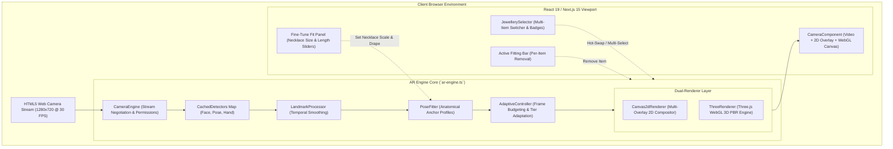
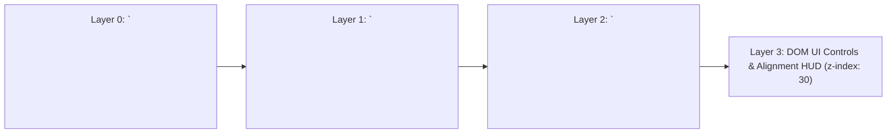

# Lumière Virtual Jewellery Studio — Architecture Overview

> [!NOTE]
> Lumière is an entirely on-device, client-side Augmented Reality (AR) atelier built on **Next.js 15 (App Router)**, **React 19**, **Three.js**, and **MediaPipe Tasks Vision**. Live video frames never leave the user's browser, providing zero latency, sub-millimeter tracking accuracy, and 100% biometric privacy.

---

## 1. High-Level System Architecture



---

## 2. Core Modules & Responsibilities

| Module | Location | Primary Responsibilities |
|---|---|---|
| **AR Engine Facade** | [`frontend/src/ar-engine/ar-engine.ts`](frontend/src/ar-engine/ar-engine.ts) | Manages the main rAF render loop, detector scheduling, multi-item fit resolution, and event broadcasting. |
| **Camera Engine** | [`frontend/src/ar-engine/camera/camera-engine.ts`](frontend/src/ar-engine/camera/camera-engine.ts) | Enforces 720p @ 30 FPS constraint ladders, device switching, facing flip, and camera health watchdog. |
| **Model Detectors** | [`frontend/src/ar-engine/detectors/`](frontend/src/ar-engine/detectors/) | Encapsulates MediaPipe Tasks Vision (`FaceLandmarker`, `PoseLandmarkerLite`, `HandLandmarker`). |
| **Pose Fitter** | [`frontend/src/ar-engine/fitting/pose-fitter.ts`](frontend/src/ar-engine/fitting/pose-fitter.ts) | Maps 2D/3D landmarks to real physical jewellery anchors, calculating orientation, scale, and spring damping. |
| **Canvas 2D Renderer** | [`frontend/src/ar-engine/renderers/canvas2d-renderer.ts`](frontend/src/ar-engine/renderers/canvas2d-renderer.ts) | Multi-overlay 2D image compositor with bilateral earring depth sorting and catenary drape calibration. |
| **Three.js 3D Renderer** | [`frontend/src/ar-engine/renderers/three-renderer.ts`](frontend/src/ar-engine/renderers/three-renderer.ts) | Physically-based WebGL renderer for procedural gemstone rings, two-pass bangles, and finger occluders. |
| **Adaptive Controller** | [`frontend/src/ar-engine/performance/adaptive-controller.ts`](frontend/src/ar-engine/performance/adaptive-controller.ts) | Dynamic performance budgeting: dynamically lowers detection frequency and scales resolution to maintain stable FPS. |
| **Try-On Experience UI** | [`frontend/src/features/try-on/TryOnExperience.tsx`](frontend/src/features/try-on/TryOnExperience.tsx) | Studio UI orchestration: mode transitions (single vs. multi), active piece state, and camera HUD controls. |

---

## 3. The Dual-Renderer Pipeline

Lumière employs a layered rendering stack composited transparently over the underlying HTML5 `<video>` feed:



1. **Layer 0 (`HTMLVideoElement`)**: Direct WebRTC stream negotiated at 1280x720 @ 30 FPS. Mirrored via CSS `-scale-x-100` for an intuitive mirror reflection.
2. **Layer 1 (`Canvas2dRenderer`)**: Renders high-resolution transparent PNG jewellery (earrings, necklaces, chokers) in screen-space coordinate coordinates.
3. **Layer 2 (`ThreeRenderer`)**: High-performance WebGL context with transparent background rendering 3D rings, procedural bangles, and invisible depth occluders.
4. **Layer 3 (`DOM Overlays`)**: Interactive controls, alignment guides, active fitting pill bars, and capture triggers.

---

## 4. Persistent Detector Caching

Previous architectures disposed and reloaded ML models whenever a user switched pieces or categories. In Lumière, models are cached in a persistent Map inside `ArEngine`:

```typescript
// frontend/src/ar-engine/ar-engine.ts
private readonly cachedDetectors = new Map<'face' | 'hand' | 'pose', ModelAdapter>();

private async getOrLoadDetector(detectorKind: 'face' | 'hand' | 'pose'): Promise<ModelAdapter> {
  let detector = this.cachedDetectors.get(detectorKind);
  if (!detector) {
    detector = this._createDetector(detectorKind);
    await detector.load();
    this.cachedDetectors.set(detectorKind, detector);
  }
  return detector;
}
```

> [!TIP]
> Once loaded, switching between an Earring (`face`), a Necklace (`pose`), and a Ring (`hand`) happens instantaneously with zero frame freeze, zero memory leak, and no camera stream interruption.
