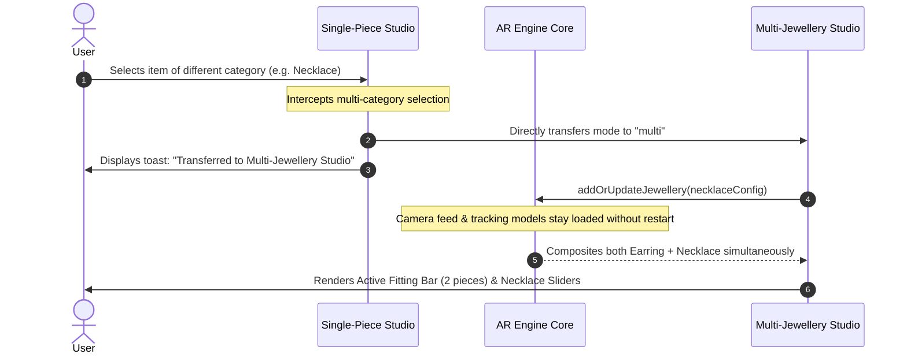

# Virtual Fitting Studio & Multi-Jewellery Atelier

> [!IMPORTANT]
> Lumière provides two distinct operating modes:
> 1. **Single-Piece Studio (`mode="single"`)**: Focused trial for an individual piece with full universal fine-tuning controls.
> 2. **Multi-Jewellery Studio (`mode="multi"`)**: Mix & match multiple fine jewellery pieces simultaneously across categories (Necklace + Earrings + Rings + Bangles). Fine-tuning in this mode is strictly dedicated to **Necklace Size and Drape Length**.

---

## 1. Studio Modes Comparison

| Feature | Single-Piece Studio | Multi-Jewellery Studio |
|---|---|---|
| **Primary Route** | `/try-on` or `/try-on/[productId]` | `/try-on/multi` |
| **Simultaneous Pieces** | 1 piece | Unlimited (1 per category: Necklace, Earrings, Rings, Bangles) |
| **Selecting Different Category** | **Directly transfers** session to Multi-Jewellery Studio | Adds or replaces that category item |
| **Selecting Same Category** | Swaps active piece immediately without camera restart | Swaps that category piece immediately |
| **Fine-Tune Sliders** | Universal: Size Ratio (80%–120%) + Vertical Position (±30px) | **Restricted to Necklace**: Necklace Size (80%–120%) + Drape Length (±30px) |
| **Item Removal** | Not applicable (always 1 item active) | Individual per-item `× Remove` button on pills and cards |
| **Active Fitting Bar** | Hidden | Visible: Interactive pill bar with quick removal |

---

## 2. Automatic Direct Transfer UX

In the normal single-piece window, users cannot choose multiple jewellery pieces. If a user tries to select an item from a different category (e.g., they are trying an earring and select a necklace):



> [!NOTE]
> The camera stream and vision models **never drop or restart** during the transfer. The transition is instantaneous and seamless.

---

## 3. Multi-Jewellery Fitting Bar

When in Multi-Jewellery mode, an **Active Multi-Fitting Bar** is prominently displayed above the piece switcher:

```
┌────────────────────────────────────────────────────────────────────────┐
│ ✨ ACTIVE MULTI-FITTING (3 pieces)                 [Exit Multi Mode]   │
│                                                                        │
│ [NECKLACE: Royal Diamond Choker  ×]                                    │
│ [EARRINGS: Chandelier Drops      ×]                                    │
│ [RINGS:    Royal Ruby Pavé       ×]                                    │
└────────────────────────────────────────────────────────────────────────┘
```

- **Per-Item Removal**: Clicking the `×` button on any pill or on the item card invokes `handleRemovePiece(item)`:
  - Disposes the 2D overlay or 3D mesh for that item.
  - Updates the active jewellery map in `ArEngine`.
  - Leaves all other worn pieces and the live camera feed active.
- **Exit Multi Mode**: Returns the studio to Single-Piece mode, keeping the primary selected piece.

---

## 4. Fine-Tune Fit Calibration

### 4.1 In Multi-Jewellery Mode (Necklace Only)
In Multi-Jewellery mode, controls are strictly isolated to the **Necklace**:

1. **Necklace Size Slider**: Adjusts scale between $80\%$ and $120\%$ in steps of $2\%$.
2. **Necklace Length (Drape) Slider**: Offsets the vertical drape point from $-30\text{px}$ (choker collar) to $+30\text{px}$ (extended chest drop).
3. **Empty Necklace Guard**: If no necklace is currently equipped in the multi fitting, the panel displays:
   > *"Add a necklace to the fitting to adjust size and drape length."*  
   > *(Includes a one-click button: `Browse Necklaces`)*

```typescript
// frontend/src/features/try-on/TryOnExperience.tsx
const handleNecklaceFineTuneChange = (scale: number, y: number) => {
  setNecklaceScale(scale);
  setNecklaceLengthY(y);
  engineRef.current?.setNecklaceFineTune(scale, y);
};
```

### 4.2 In Single-Piece Mode (Universal)
In Single-Piece mode, the Fine-Tune card controls whatever single item is currently worn:
- **Size Ratio**: Adjusts item scaling relative to anatomical anchor dimensions.
- **Vertical Position**: Fine-tunes attachment height along the local face/pose normal vector.
- **Transfer Banner**: Includes a one-click button to jump directly into Multi-Jewellery Studio.

---

## 5. Asset Preloading Strategy

To ensure zero lag when switching pieces in studio:
1. When the piece selector is mounted, all item URLs are warmed using `assetCache.preloadMany(urls)`.
2. For 3D glTF/GLB models, `warmCache(url)` downloads and decodes geometries in background workers.
3. For 2D PNG overlays, image elements are decoded via `HTMLImageElement.decode()` into browser bitmap caches before assignment to the active renderer.
