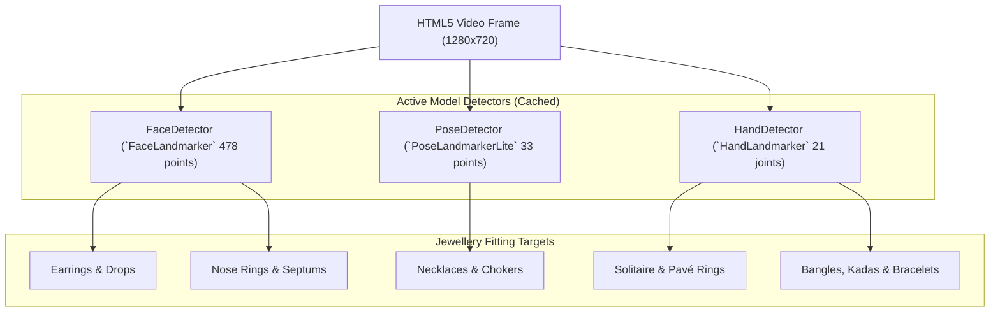

# Computer Vision & Landmark Alignment Calibration

> [!NOTE]
> Lumière uses Google **MediaPipe Tasks Vision** compiled to WebAssembly (WASM) with CPU/GPU hardware delegates. All tracking algorithms operate on calibrated anatomical anchors to achieve natural, stable jewellery drape without jitter.

---

## 1. Supported Model Detectors



---

## 2. Anatomical Calibration Formulas

### 2.1 Earrings & Drops
- **Landmark Anchors**: Dual earlobes via MediaPipe Face Mesh landmarks `177` (left earlobe) and `401` (right earlobe).
- **Inter-Pupillary Distance (IPD)**:
  $$\text{IPD} = \sqrt{(x_{468} - x_{473})^2 + (y_{468} - y_{473})^2}$$
- **Dynamic Sizing**:
  $$\text{Earring Width} = \max\left(14,\; \min\left(64,\; \text{Face Width} \times 0.12\right)\right)$$
- **Attachment Offset**: Anchor top hook at `originY = -h * 0.08` so drops suspend naturally below the earlobe rather than cutting into the jawline.
- **Perspective Yaw Occlusion**:
  $$\text{Yaw} = \arctan2\left(z_{\text{nose}} - z_{\text{mid\_ears}},\; x_{\text{nose}} - x_{\text{mid\_ears}}\right)$$
  When $|\text{Yaw}| > 35^\circ$ ($0.61\text{ rad}$), the occluded earlobe earring smoothly fades out via opacity interpolation.

---

### 2.2 Necklaces, Pendants & Mangalsutras
- **Landmark Anchors**: Clavicle notch and shoulder acromia (MediaPipe Pose landmarks `11` = Left Shoulder, `12` = Right Shoulder):
  $$\vec{P}_{\text{neck\_base}} = \frac{\vec{P}_{11} + \vec{P}_{12}}{2}$$
- **Biacromial Shoulder Width**:
  $$W_{\text{shoulder}} = \|\vec{P}_{11} - \vec{P}_{12}\|$$
- **Dynamic Scaling**:
  $$\text{Target Scale} = \max\left(0.60,\; \min\left(1.50,\; 1.0 + \frac{\text{fineTuneOffsetY}}{70}\right)\right) \times \frac{W_{\text{shoulder}}}{240}$$
- **Necklace Drape Adjustment**:
  $$\text{Final Position Y} = \vec{P}_{\text{neck\_base}}.y + \text{fineTuneOffsetY}$$
  Moving the slider up (negative Y) simulates a tighter choker collar; moving the slider down (positive Y) lets the chain drop into a natural, catenary drape.

---

### 2.3 Solitaire & Gemstone Rings
- **Landmark Anchors**: Proximal Interphalangeal (PIP = landmark `13`) and Distal Interphalangeal (DIP = landmark `14`) joints of the ring finger.
- **Finger Direction Vector**:
  $$\vec{V}_{\text{finger}} = \vec{P}_{14} - \vec{P}_{13}, \quad \hat{z} = \frac{\vec{V}_{\text{finger}}}{\|\vec{V}_{\text{finger}}\|}$$
- **Gram-Schmidt Normalization**:
  $$\vec{N}_{\text{palm}} = (\vec{P}_5 - \vec{P}_0) \times (\vec{P}_{17} - \vec{P}_0)$$
  $$\vec{U}_{\text{up}} = \text{normalize}\left(\vec{N}_{\text{palm}} - \hat{z} \cdot (\vec{N}_{\text{palm}} \cdot \hat{z})\right)$$
  $$\vec{U}_{\text{right}} = \vec{U}_{\text{up}} \times \hat{z}$$
- **3D Rotation Matrix**: Formulated from orthogonal basis vectors $(\vec{U}_{\text{right}}, \vec{U}_{\text{up}}, \hat{z})$ and converted to a Three.js Quaternion with SLERP damping ($\alpha = 0.40$).

---

### 2.4 Bangles, Kadas & Bracelets
- **Landmark Anchors**: Wrist joint (landmark `0`) and middle finger MCP joint (landmark `9`).
- **Forearm Vector**:
  $$\vec{V}_{\text{arm}} = \vec{P}_9 - \vec{P}_0, \quad \theta_{\text{roll}} = -\arctan2(\vec{V}_{\text{arm}}.y,\; \vec{V}_{\text{arm}}.x)$$
- **Dynamic Width & Radius**:
  $$\text{Palm Width} = \|\vec{P}_5 - \vec{P}_{17}\|$$
  $$\text{Bangle Radius} = \frac{\text{Palm Width} \times 1.22}{2}$$

---

## 3. Multi-Detector Concurrent Scheduling

When in Multi-Jewellery Mode with multiple categories active (e.g. Earrings + Necklace + Ring), `ArEngine` executes detection across required models without blocking the 60 FPS rAF loop:

```typescript
// frontend/src/ar-engine/ar-engine.ts
private async runDetection(): Promise<void> {
  if (this.detecting || !this.host) return;
  this.detecting = true;
  try {
    const needed = new Set<'face' | 'hand' | 'pose'>();
    for (const entry of this.activeJewellery.values()) {
      needed.add(AnchorRegistry.get(entry.config.jewelleryKind).detector);
    }
    for (const detectorKind of needed) {
      const det = await this.getOrLoadDetector(detectorKind);
      const raw = await det.estimate(this.host.video);
      const { result } = this.processor.process(raw);
      this.lastLandmarksMap.set(detectorKind, result);
    }
  } finally {
    this.detecting = false;
  }
}
```

> [!TIP]
> Detection runs asynchronously at ~15–20 Hz in background WebAssembly worker threads, while the render loop smoothly interpolates jewellery transforms at full display refresh rate (60 FPS).
