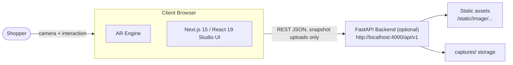

# HIGH-LEVEL DESIGN (HLD)

| | |
|---|---|
| **Product** | Lumière — AI Virtual Jewellery Try-On Studio |
| **Version** | 1.0 |
| **Sources** | `docs/ARCHITECTURE.md`, `README.md`, `server.py` |

## 1. Design Summary

Lumière is an on-device AR application. The browser hosts the entire vision and rendering pipeline — live webcam frames are processed locally by MediaPipe Tasks Vision (WASM) and composited by a dual renderer (Canvas2D + Three.js WebGL) over the video element. An **optional** FastAPI backend supplies catalogue data, try-on session bookkeeping, and capture storage. The frontend runs fully standalone via an embedded fallback catalogue, so there is **zero mandatory server or database dependency**.

**Key principles**
1. **Privacy by architecture** — video frames never leave the browser.
2. **Decoupled rates** — ML inference at 15–20 Hz; rendering/interpolation at 60 FPS.
3. **Load-once models** — persistent detector cache eliminates swap-time reloads.
4. **Layered compositing** — video → 2D overlays → 3D WebGL → DOM HUD.

## 2. System Context

## 3. Deployment View

| Unit | Technology | Location | Notes |
|---|---|---|---|
| Web Atelier | Next.js 15 App Router, React 19, TypeScript | `frontend/` — dev `:3000`, prod via `pnpm build && pnpm start` | Standalone capable (offline catalogue + bundled models) |
| Vision runtime | MediaPipe Tasks Vision WASM + `.task` models | Bundled in `frontend/public/models/` | simd / module / nosimd variants shipped |
| Experience API | FastAPI + uvicorn + pydantic v2 (`server.py`) | `:4000` | Optional; CORS enabled for `:3000` |
| Asset store | Filesystem | `static/Image/`, `captures/` | Mounted at `/static` and `/captures` |

## 4. Subsystem Decomposition

| Subsystem | Repository Area | Responsibility |
|---|---|---|
| **AR Engine** | `frontend/src/ar-engine/` | rAF render loop, detector scheduling, fit resolution, event broadcasting |
| Camera | `ar-engine/camera/` | 720p@30 constraint ladders, device switching, health watchdog |
| Detectors | `ar-engine/detectors/` | FaceLandmarker (478 pts), PoseLandmarkerLite (33 pts), HandLandmarker (21 joints) wrappers |
| Fitting | `ar-engine/fitting/` | Anatomical anchor math, spring damping |
| Renderers | `ar-engine/renderers/` | Canvas2D compositor; Three.js PBR WebGL engine |
| Performance | `ar-engine/performance/` | Adaptive frame-budget control |
| Capture | `ar-engine/capture/` | High-resolution snapshot compositing |
| **Try-On Studio UI** | `frontend/src/features/try-on/`, `components/try-on/` | Single/multi modes, fitting bar, fine-tune sliders |
| **Storefront** | `frontend/src/app/(shop)/`, `components/catalog/` | Catalogue browsing, product pages |
| **Shared layers** | `stores/` (Zustand), `api-client/`, `ui/`, `hooks/`, `lib/` | State, typed API access, design system, asset caching |
| **Backend API** | `server.py` | Catalogue/settings endpoints, session lifecycle, uploads/captures, static serving |

## 5. Render Layer Stack

| Layer | Element | z-index | Content |
|---|---|---|---|
| L0 | `<video>` | — | Live mirrored webcam stream (CSS `-scale-x-100`) |
| L1 | `<canvas>` 2D | 10 | PNG overlay jewellery (earrings, necklaces) |
| L2 | `<canvas>` WebGL | 20 | Three.js rings, bangles, occluders |
| L3 | DOM | 30 | HUD, fitting bar, sliders, capture button |

## 6. Key Design Decisions

| # | Decision | Rationale | Reference |
|---|---|---|---|
| DD-1 | Persistent `cachedDetectors` Map instead of per-piece model lifecycle | Eliminates freeze/reload when switching pieces or categories | `docs/ARCHITECTURE.md` §4 |
| DD-2 | Detection decoupled from rendering; spring-damped interpolation at display refresh | 60 FPS smoothness despite 15–20 Hz WASM inference | `docs/VISION_AND_TRACKING.md` §3 |
| DD-3 | React state throttling (FPS every 500 ms; status/error immediate) | 97% re-render reduction; removes slider-drag lag | `DOCUMENTATION.md` §5.2 |
| DD-4 | Colored gems use `transmission=0` + emissive tint + flat shading | Transmission refracts HDR white env and washes out ruby/sapphire/emerald/amethyst colour | `docs/3D_SHADING_AND_MATERIALS.md` §1 |
| DD-5 | Two-pass bangle shading (opaque front / translucent back arc) | Single pass renders rear arc over the wrist or clips it | `docs/3D_SHADING_AND_MATERIALS.md` §3 |
| DD-6 | Cross-category pick transfers Single → Multi session live | Users keep camera and models; no restart | `docs/TRY_ON_STUDIO.md` §2 |
| DD-7 | Backend optional; frontend fallback catalogue | Studio demoable/deployable with zero infrastructure | `docs/DEVELOPER_GUIDE.md` note, `README.md` |

## 7. Cross-Cutting Concerns

- **Privacy:** only explicit user-triggered snapshot uploads reach the server; landmarks/frames never do.
- **Security (deployment note):** dev CORS is `allow_origins=["*"]`; production hosting must restrict to the deployed frontend origin (see Risk R-09 and Runbook).
- **Error handling:** standard API envelope; 404s for unknown categories/products/sessions/captures.
- **Debug aids:** `Axes [X]` toggle renders ring coordinate axes for orientation QA.

Module-level internals (algorithms, formulas, state machines) are specified in [LLD.md](./02_LLD.md).
