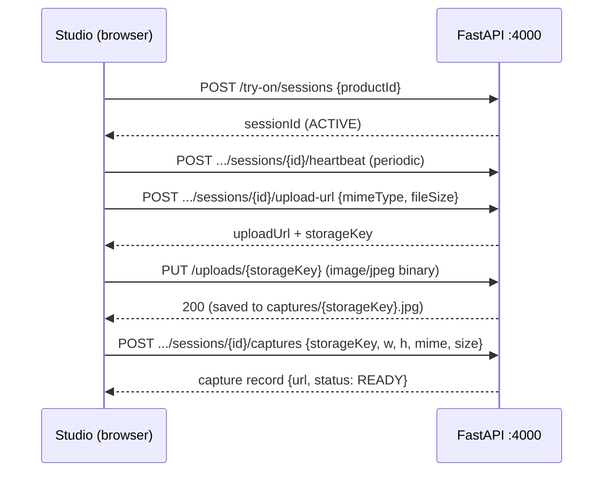

# API SPECIFICATION

| | |
|---|---|
| **Service** | Lumière Virtual Try-On Backend API (FastAPI) |
| **Base URL** | `http://localhost:4000/api/v1` |
| **Version** | 1.0.0 |
| **Source of truth** | `server.py`; interactive docs at `http://localhost:4000/api/docs`, OpenAPI schema at `/api/openapi.json` |

## 1. Conventions

### 1.1 Response Envelope
Every JSON endpoint (except `PUT /uploads/{key}` which returns a bare 200, and `/` health) responds:

```json
{
 "success": true,
 "data": { },
 "meta": {
 "requestId": "<uuid4>",
 "timestamp": "<ISO-8601 UTC>Z",
 "pagination": { "page": 1, "pageSize": 20, "total": 17, "totalPages": 1 }
 }
}
```
`pagination` is present only on list endpoints.

### 1.2 Errors
Standard FastAPI HTTP errors, e.g. `404 {"detail": "Product not found"}` for unknown category/product/session/capture.

### 1.3 CORS
Configured for the frontend at `http://localhost:3000`; current code allows all origins (dev setting — restrict before public deployment).

## 2. Endpoints

### 2.1 Catalogue
| Method | Path | Query / Body | Response `data` |
|---|---|---|---|
| GET | `/categories` | `flat?: bool`, `isActive?: bool` | List of category objects `{id, name, slug, parentId, description, sortOrder, isActive}` |
| GET | `/categories/{id_or_slug}` | — | Category object; 404 if unknown |
| GET | `/products` | `page≥1` (1), `pageSize 1–100` (20), `categoryId?`, `jewelleryKind?` (case-insensitive), `q?` (matches name or SKU) | List of summary product DTOs + pagination |
| GET | `/products/{id_or_slug}` | Lookup by `id`, `slug`, or `sku` | Detailed product DTO (see §3) |

### 2.2 Settings
| Method | Path | Response `data` |
|---|---|---|
| GET | `/settings/public` | `{guestTryOnEnabled: true, brandName: "Lumière", supportEmail: "support@lumiere.com"}` |

### 2.3 Try-On Sessions
| Method | Path | Request | Response `data` |
|---|---|---|---|
| POST | `/try-on/sessions` | `{productId, clientInfo?}` | `{sessionId: "sess_<12hex>", productId, jewelleryKind, asset, status: "ACTIVE", createdAt, lastHeartbeat}` (unknown productId falls back to first catalogue item) |
| GET | `/try-on/sessions/{sessionId}` | — | Session object; 404 unknown |
| PATCH | `/try-on/sessions/{sessionId}` | `{status?}` | Updated session; heartbeat refreshed |
| POST | `/try-on/sessions/{sessionId}/heartbeat` | — | `{ok: true, status}` (unknown session still returns `ok, ACTIVE`) |
| POST | `/try-on/sessions/{sessionId}/events/batch` | event batch payload | `{ok: true}` |

### 2.4 Try-On Assets
| Method | Path | Request | Response `data` |
|---|---|---|---|
| GET | `/try-on/products/{productId}/asset` | — | `{productId, jewelleryKind, asset}` or `data: null` if unknown |
| POST | `/try-on/products/assets` | `{productIds: string[]}` | Array of `{productId, jewelleryKind, asset}` (unknown ids skipped) |

### 2.5 Captures
| Method | Path | Request | Response |
|---|---|---|---|
| POST | `/try-on/sessions/{sessionId}/upload-url` | `{mimeType, fileSize}` | `{uploadUrl: "http://localhost:4000/api/v1/uploads/<storageKey>", storageKey: "cap_<14hex>", headers: {Content-Type}, expiresIn: 3600}` |
| PUT | `/uploads/{storageKey}` | Raw image body | `200` (empty). Writes `captures/<storageKey>.jpg` and mirrors latest to root `captured_image_with_jewelry.png` |
| POST | `/try-on/sessions/{sessionId}/captures` | `{storageKey, width, height, mimeType, fileSizeBytes}` | `{id: "cap_<8hex>", sessionId, status: "READY", url, thumbUrl, createdAt}` — served from `/captures/<storageKey>.jpg` |
| GET | `/try-on/captures` | `page` | Capture list + pagination |
| GET | `/try-on/captures/{captureId}` | — | Capture object; 404 unknown |
| GET | `/try-on/captures/{captureId}/download` | — | `{downloadUrl, fileName: "lumiere_tryon_<id>.jpg", expiresIn: 3600}` |

### 2.6 Auth (guest/demo stubs)
| Method | Path | Request | Response `data` |
|---|---|---|---|
| POST | `/auth/login` | `{email, ...}` | `{user: {id: "user-guest", email, fullName: "Guest User", role: "USER"}, tokens: {accessToken, refreshToken, expiresIn: 86400}}` |
| POST | `/auth/register` | `{email, fullName, ...}` | Same shape as login |
| POST | `/auth/refresh` | — | `{tokens: {...}}` |
| GET | `/auth/me` | — | Guest user object |

### 2.7 Service
| Method | Path | Response |
|---|---|---|
| GET | `/` (root) | `{service, status: "online", endpoints: "/api/docs", productsCount}` |
| GET | `/static/...` | Static file (product imagery) |
| GET | `/captures/...` | Static file (saved snapshots) |

## 3. Product DTO (detailed)

```json
{
 "id": "prod-ring-002",
 "name": "Royal Ruby Pavé Crown Ring",
 "slug": "royal-ruby-pave-crown-ring",
 "sku": "VJ-RING-002",
 "jewelleryKind": "RINGS",
 "status": "PUBLISHED",
 "category": { "id": "cat-rings", "name": "Rings", "slug": "rings" },
 "primaryImage": { "id": "img-prod-ring-002", "url": "/static/Image/Ring/ring_2.png", "altText": "...", "sortOrder": 0, "isPrimary": true },
 "priceCents": 2399900,
 "currency": "INR",
 "description": "...",
 "images": [ /* same image DTO */ ],
 "tryOnAsset": {
 "id": "asset-prod-ring-002",
 "assetType": "IMAGE_OVERLAY",
 "url": "/static/Image/Ring/ring_2.png",
 "anchorProfile": { "anchorType": "FINGER_BASE", "fingerIndex": 3 },
 "defaultScale": 1.0,
 "defaultRotationZ": 0,
 "mirrorForOppositeEar": false,
 "fingerIndex": 3,
 "isActive": true
 },
 "metadata": {
 "ringConfig": {
 "id": "prod-ring-002", "gemColor": "#E0115F", "gemShape": "princess",
 "gemScale": 1.08, "bandMetal": "yellow", "bandThickness": 0.11,
 "hasHalo": false, "haloColor": "#FFFFFF", "accentStones": true
 }
 }
}
```

Anchor profile values in use: `SUPRASTERNAL_NOTCH` (necklaces), `EAR_LOBE` + `earSide: BOTH` (earrings), `FINGER_BASE` + `fingerIndex: 3` (rings), `WRIST` (bangles).

## 4. Capture Upload Sequence


