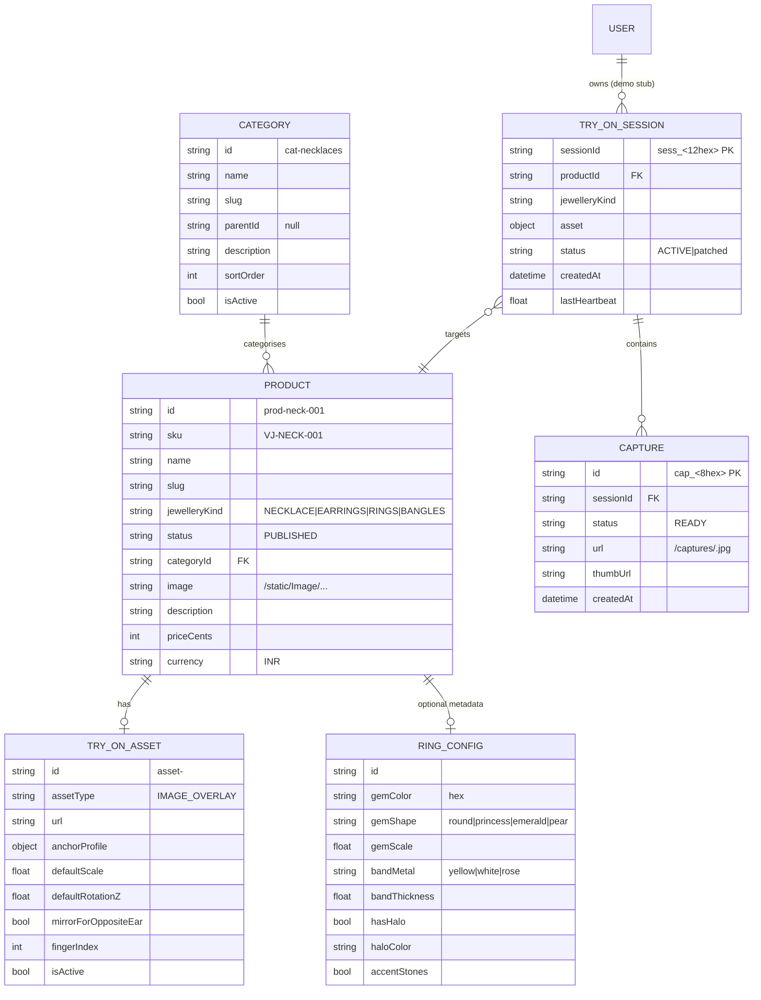

# DATA MODEL

| | |
|---|---|
| **Product** | Lumière — AI Virtual Jewellery Try-On Studio |
| **Version** | 1.0 |
| **Sources** | `server.py` (stores & DTOs), `frontend/src/types/catalog.ts`, `frontend/src/features/try-on/fallback-catalogue.ts` |

## 1. Persistence Model

The system has **no database by design**:
- Backend holds catalogue in module constants (`CATEGORIES`, `PRODUCTS_MASTER`), sessions in memory (`SESSIONS` dict), captures in a list (`CAPTURES`) plus JPEG files on disk under `captures/`.
- Frontend state lives in Zustand stores (`try-on-store.ts`, `studio-store.ts`, `auth-store.ts`, `catalog-filters-store.ts`) and the browser asset cache (`lib/asset-cache.ts`).

## 2. Entity Diagram (logical)

## 3. Anchor Profile Vocabulary (in use in `PRODUCTS_MASTER`)

| jewelleryKind | anchorProfile | Extra fields |
|---|---|---|
| NECKLACE | `{anchorType: "SUPRASTERNAL_NOTCH"}` | — |
| EARRINGS | `{anchorType: "EAR_LOBE", earSide: "BOTH"}` | `mirrorForOppositeEar: true` |
| RINGS | `{anchorType: "FINGER_BASE", fingerIndex: 3}` | `metadata.ringConfig` present |
| BANGLES | `{anchorType: "WRIST"}` | — |

## 4. Catalogue Inventory (as shipped)

| Category | Count | Image assets |
|---|---|---|
| Necklaces | 4 | `static/Image/Necklace/necklace_{1,20,24,28}.png` |
| Earrings | 5 | `static/Image/Earring/earring_{1..5}.png` |
| Rings | 5 | `static/Image/Ring/ring_{1..5}.png` (+ 3D `ringConfig` each) |
| Bangles | 4 | `static/Image/Bangle/bangle_{1..4}.png` |
| **Total products** | **17** | Mirrored under `frontend/public/static/Image/` |

Additional SVG catalogue icons exist under `frontend/public/assets/` (necklace, earring, ring, bangle, nosering variants); nose-ring SVGs are present in the asset set even though no nose-ring products are in the shipped catalogue.

## 5. Frontend Catalogue Types
Typed contracts in `frontend/src/types/catalog.ts` / `try-on.ts`, consumed by `frontend/src/api-client/services.ts`; the offline mirror in `fallback-catalogue.ts` uses the same shape (`tryOnAsset.renderScale`, `renderOffsetY` per `DEVELOPER_GUIDE.md` §3.1).
